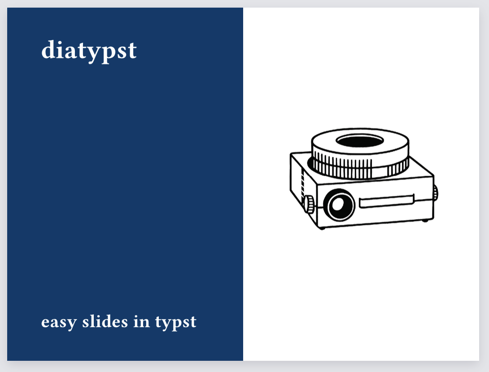

# How to change the first slide?

For many presentations, it is quite useful to be able to control the appearance of the first slide. diatypst therefore has the option to disable the default title slide (`first-slide: false`) and allow users to create their own. This is a bit more complicated, but gives you more freedom to include logos etc.

**Note:** if you only want to add a logo, use the `logo` option!

To do that, you have to add your custom slide before calling `slides.with`. You need to also adjust the sizing of your custom slide to the ratio and layout you chose. 

```typst
#import "@preview/diatypst:0.10.0": *

#set page(
  footer: none, header: none, margin: 0cm,
  height: 10.5cm, // height is either 9cm, 10.5cm or 12cm
  width: 4/3*10.5cm, // width is your height * your ratio
)

// Custom Title Slide Content goes here

#show: slides.with(
  ...,
  first-slide: false,
  ...
```


## Example: change the layout of the first slide

You can be creative in changing the layout of the first slide, for example:

```typst
#import "@preview/diatypst:0.10.0": *

#set page(
  footer: none, header: none, margin: 0cm,
  height: 10.5cm, // height is either 9cm, 10.5cm or 12cm
  width: 4/3*10.5cm, // width is your height * your ratio
)

// Custom Slide
#grid(
  columns: 2,
  fill: (blue.darken(50%), white),
  {
    block(
      width: 100%, 
      height: 100%, 
      inset: 1cm,
      text(2.0em, weight: "bold", fill: white)[diatypst] +
      linebreak() +
      align(bottom, text(1.4em, fill: white, weight: "bold", "easy slides in typst"))
    )
  }, 
  {
    block(
      width: 100%, 
      height: 100%,
      inset: 1cm,
      align(horizon+right, image("icon.png", width: 100%))
    )
  }
)

// Now call the diatypst funcion
#show: slides.with(
  ...,
  first-slide: false,
  ...
)
```

The result will look like this:


